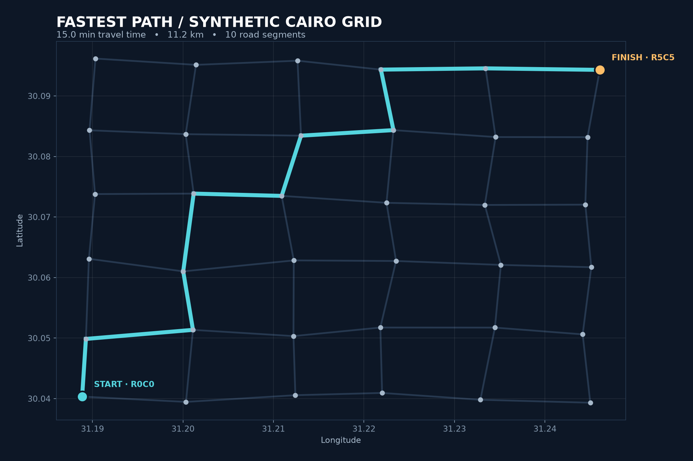

# Graph Route Optimizer

Find the fastest route across a **synthetic** street grid, then compare Dijkstra with A*. The coordinates are placed near Cairo for a recognizable latitude/longitude view; the streets and travel speeds are generated and are **not real navigation data**.

## What the project shows

- A connected, seeded 6 × 6 road graph with 36 intersections and 60 road segments.
- Edge travel time from geodesic distance and a 25, 35, or 50 km/h road speed.
- Dijkstra and A* search modes, checked against NetworkX's shortest-path result.
- An interactive [Plotly route map](assets/route-map.html), a PNG preview, the generated CSV network, and a JSON comparison.

Data flow: **fixed seed → node/road CSVs → graph search → route comparison → visualizations**.

## Run

Requires Python 3.10 or newer. From this directory:

~~~powershell
python -m venv .venv
.\.venv\Scripts\python.exe -m pip install -r requirements.txt
.\.venv\Scripts\python.exe route_optimizer.py --output-dir artifacts
.\.venv\Scripts\python.exe -m pytest -q
~~~

On macOS or Linux, use the executable at .venv/bin/python in place of the Windows venv executable. The HTML includes Plotly's JavaScript bundle and opens offline. The generated CSV and PNG also require no network connection.

Use the default seed 42, start R0C0, and goal R5C5 to reproduce the committed example. Start and goal must be node IDs in the generated grid.

## Metrics and algorithm

The objective is **minimum travel time**, not minimum distance. An edge's minutes equal distance_km / speed_kmh × 60. Distance shown in the result is the sum of the selected road lengths.

A* estimates remaining minutes from the straight-line haversine distance at 50 km/h. All generated roads are at or below 50 km/h, and a road route cannot be shorter than the straight-line distance. This makes the heuristic admissible and consistent for this network. Dijkstra uses the same search with a zero heuristic.

For the committed seed-42 example, both algorithms return **15.032452 minutes** over **11.219901 km**. Dijkstra expands 36 nodes; A* expands 30. These expansion counts describe this one small graph, not a general speed benchmark. See [comparison.json](assets/comparison.json).

## Verification

The tests cover a hand-checked three-node route, same-node and disconnected cases, A* admissibility against NetworkX for every generated node, agreement on the optimal cost, and deterministic CSV export. Run python -m pytest -q.

All records are generated by this repository. There are no real road, traffic, or personal datasets to attribute.
